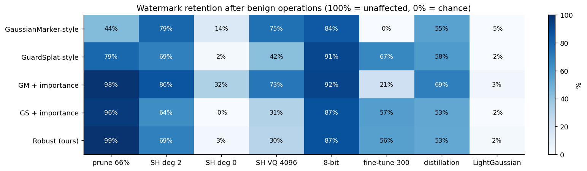
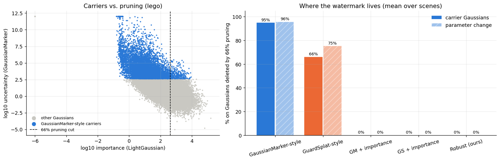
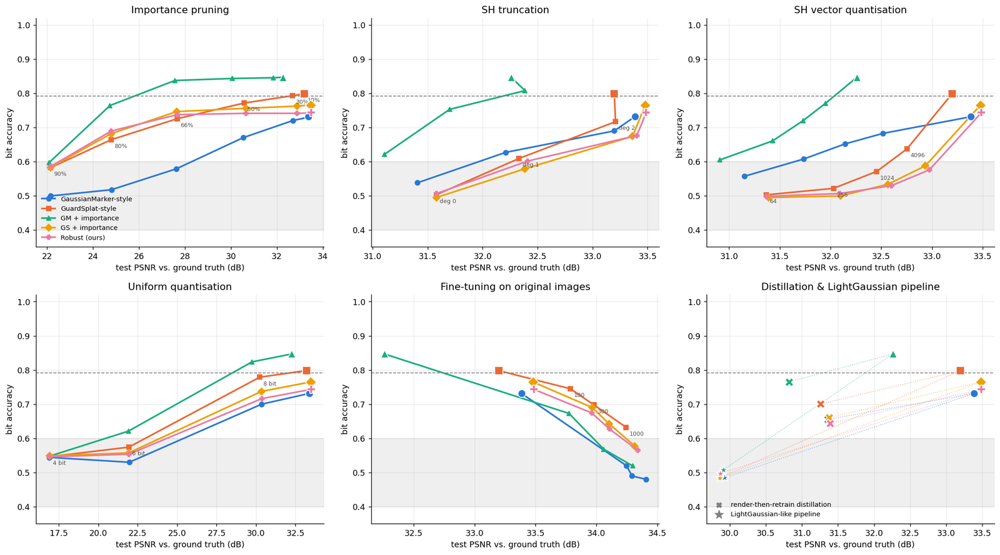
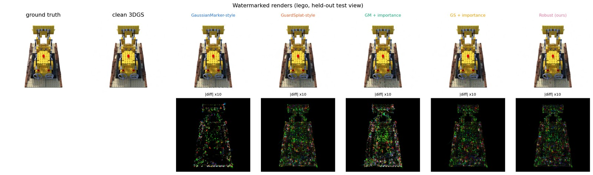

# Do 3D Gaussian Splatting watermarks survive compression?

**GaussianMarker** (NeurIPS 2024) and **GuardSplat** (CVPR 2025) embed ownership watermarks in 3D Gaussian Splatting
(3DGS) scenes. 3DGS files are huge, so in practice scenes are **pruned, quantised, fine-tuned or re-trained**.
This project checks what those *benign* operations do to the watermark, explains why it disappears, and tests a
simple fix.

**Notebook:** [`gs_watermark_robustness.ipynb`](gs_watermark_robustness.ipynb) (executed on a Kaggle T4, about 40 min,
all outputs included)

Retention = (bit accuracy after − 0.5) / (bit accuracy before − 0.5), averaged over 3 scenes. 100% means the
operation did not weaken the watermark; 0% means it is back to chance.

## Key findings

1. **A standard compression pipeline erases every watermark.** A LightGaussian-like pipeline (prune 66% → 500
   recovery steps → SH degree 2 → SH vector quantisation → 8-bit) makes the file **~37× smaller** and keeps the scene
   usable (about 30 dB PSNR), but drives
   *all five* methods back to chance, including the fixes.
2. **GaussianMarker-style selection is anti-aligned with pruning.** Its high-uncertainty carrier Gaussians are the
   ones that barely affect the image, and those are exactly what importance pruning deletes first: **95% of the
   carriers** fall below LightGaussian's 66% cut. Pruning 66% keeps only 44% of the watermark.
3. **The fix works for pruning.** Embedding only in the top-34% most important Gaussians raises retention after 66%
   pruning to **96–99%** for both method families.
4. **Each family has its own weak spot.**
   - Fine-tuning for 300 steps erases geometry-carried watermarks (0–21% retained).
   - Truncating the SH to degree 0 erases the SH-carried (GuardSplat-style) ones (0–3%).
   - 8-bit quantisation is harmless.
5. **Render-then-retrain distillation does *not* remove the watermark** (53–69% retained). The watermark lives in the
   pixels, so a fresh model trained on the renders re-learns it.
6. **Compression-aware augmentation during embedding did not help** beyond importance carriers alone. This is an
   honest negative result, and it points to fine-tuning-aware embedding as the next step.

## Setup

| | |
|---|---|
| scenes | NeRF-synthetic `lego`, `hotdog`, `ficus` at 400×400. 3DGS trained with [`gsplat`](https://github.com/nerfstudio-project/gsplat) for 7k steps (test PSNR 31–38 dB) |
| message | 48 bits, read from renders of **40 held-out test views** with the public 48-bit HiDDeN decoder from [Stable Signature](https://github.com/facebookresearch/stable_signature), shared by all methods |
| metrics | bit accuracy; detection rate (views with ≥ 38/48 correct bits, a binomial test at FPR 1e-4); test PSNR; retention |
| embedding | 1500 steps on training + random views; loss = BCE(decoded bits) + λ·(L1 + D-SSIM) to the clean render |

| method | carrier Gaussians | optimised parameters |
|---|---|---|
| GaussianMarker-style | top-20% **uncertainty** (inverse diagonal Fisher) | position, shape, opacity, SH |
| GuardSplat-style | all | SH colour, plus 2D distortion augmentation |
| GM + importance (fix) | top-20% uncertainty *among the top-34% importance* | all |
| GS + importance (fix) | top-34% **importance** (LightGaussian global significance) | SH |
| Robust (fix + augmentation) | top-34% importance | SH, trained under simulated pruning, SH truncation and SH noise |

| benign operation | strengths |
|---|---|
| LightGaussian importance pruning | 10–90% of Gaussians |
| SH truncation | keep degree 2 / 1 / 0 |
| SH vector quantisation (k-means) | 4096 … 64 codes |
| uniform quantisation of all attributes | 8 / 6 / 4 bits |
| fine-tuning on the original training images | 100 / 300 / 1000 steps |
| render-then-retrain distillation | fresh 3DGS, 3000 steps on 300 renders |
| LightGaussian-like pipeline | prune 66% → 500 steps → SH deg 2 → VQ 4096 → 8-bit |

## More figures

**Bit accuracy vs. PSNR for every operation and strength** (mean over scenes):

**What the watermark looks like** (difference to the clean render ×10):

[Bit accuracy vs. compression ratio](figures/bitacc_vs_compression.png) ·
[Detection rate at typical settings](figures/detection_typical.png) ·
[Renders after pruning / fine-tuning](figures/attack_examples.jpg)

Raw numbers: [`results.csv`](results.csv) (every scene × method × operation × strength),
[`results_mean.csv`](results_mean.csv), [`mechanism.csv`](mechanism.csv).

## Caveats

- These are **simplified re-implementations of the two embedding strategies** (which Gaussians and parameters carry
  the message) with one shared public decoder, not the authors' full systems. GuardSplat trains its own CLIP-based
  decoder, and GaussianMarker also uses a 3D decoder.
- The operating point is weaker than the papers report: 0.73–0.85 bit accuracy at 39–44 dB PSNR vs. the clean scene.
  λ was calibrated on `lego` so that both families sit at a similar visual cost. GM + importance ends up somewhat more
  visible (38.9 dB), which the retention metric only partly controls for.
- 3 scenes at 400×400. `ficus` (thin leaves) is much harder to watermark than `lego` or `hotdog`.
- Importance uses the projected screen-space area as a proxy for LightGaussian's per-pixel hit count.

## Run it yourself

**Everything reproduces in ~40 min on a single free Kaggle T4.** Add the dataset
`nguyenhung1903/nerf-synthetic-dataset`, enable a GPU (T4) and internet, and run the notebook. The first cell
compiles `gsplat` (about 5 min). All knobs are in that cell, and `SMOKE = True` runs a 10-minute version.
[`gs_watermark_robustness.py`](gs_watermark_robustness.py) is the same notebook in jupytext format.

## References

- Huang et al., *GaussianMarker: Uncertainty-Aware Copyright Protection of 3D Gaussian Splatting*, NeurIPS 2024
- Chen et al., *GuardSplat: Efficient and Robust Watermarking for 3D Gaussian Splatting*, CVPR 2025
- Fan et al., *LightGaussian: Unbounded 3D Gaussian Compression with 15x Reduction and 200+ FPS*, NeurIPS 2024
- Kerbl et al., *3D Gaussian Splatting for Real-Time Radiance Field Rendering*, SIGGRAPH 2023
- Fernandez et al., *The Stable Signature*, ICCV 2023 · Zhu et al., *HiDDeN*, ECCV 2018
